# Enterprise ERD

Machine-readable complete relationships: schema.json.

## audit

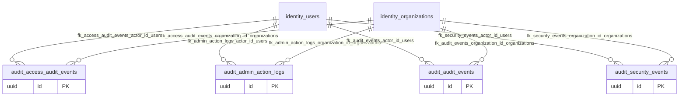

## catalog

```mermaid
erDiagram
  catalog_product_categories { uuid id PK }
  catalog_category_attributes { uuid id PK }
  catalog_product_categories ||--o{ catalog_category_attributes : "fk_category_attributes_category_id_product_categories"
  catalog_category_hierarchy { uuid id PK }
  catalog_product_categories ||--o{ catalog_category_hierarchy : "fk_category_hierarchy_child_id_product_categories"
  catalog_product_categories ||--o{ catalog_category_hierarchy : "fk_category_hierarchy_parent_id_product_categories"
  catalog_option_groups { uuid id PK }
  identity_organizations ||--o{ catalog_option_groups : "fk_option_groups_organization_id_organizations"
  catalog_price_books { uuid id PK }
  finance_currencies ||--o{ catalog_price_books : "fk_price_books_currency_id_currencies"
  identity_organizations ||--o{ catalog_price_books : "fk_price_books_organization_id_organizations"
  catalog_products { uuid id PK }
  catalog_product_categories ||--o{ catalog_products : "fk_products_category_id_product_categories"
  identity_organizations ||--o{ catalog_products : "fk_products_organization_id_organizations"
  catalog_dietary_attributes { uuid id PK }
  catalog_products ||--o{ catalog_dietary_attributes : "fk_dietary_attributes_product_id_products"
  catalog_option_values { uuid id PK }
  catalog_option_groups ||--o{ catalog_option_values : "fk_option_values_group_id_option_groups"
  catalog_pharmacy_restrictions { uuid id PK }
  geo_countries ||--o{ catalog_pharmacy_restrictions : "fk_pharmacy_restrictions_country_id_countries"
  catalog_products ||--o{ catalog_pharmacy_restrictions : "fk_pharmacy_restrictions_product_id_products"
  catalog_product_allergens { uuid id PK }
  catalog_products ||--o{ catalog_product_allergens : "fk_product_allergens_product_id_products"
  catalog_product_customizations { uuid id PK }
  catalog_option_groups ||--o{ catalog_product_customizations : "fk_product_customizations_option_group_id_option_groups"
  catalog_products ||--o{ catalog_product_customizations : "fk_product_customizations_product_id_products"
  catalog_product_images { uuid id PK }
  catalog_products ||--o{ catalog_product_images : "fk_product_images_product_id_products"
  catalog_product_options { uuid id PK }
  catalog_option_groups ||--o{ catalog_product_options : "fk_product_options_group_id_option_groups"
  catalog_products ||--o{ catalog_product_options : "fk_product_options_product_id_products"
  catalog_product_status_history { uuid id PK }
  identity_users ||--o{ catalog_product_status_history : "fk_product_status_history_actor_id_users"
  catalog_products ||--o{ catalog_product_status_history : "fk_product_status_history_product_id_products"
  catalog_product_tags { uuid id PK }
  catalog_products ||--o{ catalog_product_tags : "fk_product_tags_product_id_products"
  catalog_product_tax_categories { uuid id PK }
  catalog_products ||--o{ catalog_product_tax_categories : "fk_product_tax_categories_product_id_products"
  finance_tax_codes ||--o{ catalog_product_tax_categories : "fk_product_tax_categories_tax_code_id_tax_codes"
  catalog_product_variants { uuid id PK }
  catalog_products ||--o{ catalog_product_variants : "fk_product_variants_product_id_products"
  catalog_merchant_catalogs { uuid id PK }
  merchant_merchant_branches ||--o{ catalog_merchant_catalogs : "fk_merchant_catalogs_branch_id_merchant_branches"
  identity_organizations ||--o{ catalog_merchant_catalogs : "fk_merchant_catalogs_organization_id_organizations"
  catalog_product_availability_windows { uuid id PK }
  merchant_merchant_branches ||--o{ catalog_product_availability_windows : "fk_product_availability_windows_branch_id_merchant_branches"
  catalog_products ||--o{ catalog_product_availability_windows : "fk_product_availability_windows_product_id_products"
  catalog_product_branch_availability { uuid id PK }
  merchant_merchant_branches ||--o{ catalog_product_branch_availability : "fk_product_branch_availability_branch_id_merchant_branches"
  catalog_product_variants ||--o{ catalog_product_branch_availability : "fk_product_branch_availability_variant_id_product_variants"
  catalog_product_combinations { uuid id PK }
  catalog_product_variants ||--o{ catalog_product_combinations : "fk_product_combinations_component_variant_id_product_variants"
  catalog_products ||--o{ catalog_product_combinations : "fk_product_combinations_product_id_products"
  catalog_product_option_assignments { uuid id PK }
  catalog_option_values ||--o{ catalog_product_option_assignments : "fk_product_option_assignments_option_id_option_values"
  catalog_product_variants ||--o{ catalog_product_option_assignments : "fk_product_option_assignments_variant_id_product_variants"
  catalog_product_prices { uuid id PK }
  merchant_merchant_branches ||--o{ catalog_product_prices : "fk_product_prices_branch_id_merchant_branches"
  finance_currencies ||--o{ catalog_product_prices : "fk_product_prices_currency_currencies"
  catalog_price_books ||--o{ catalog_product_prices : "fk_product_prices_price_book_id_price_books"
  catalog_product_variants ||--o{ catalog_product_prices : "fk_product_prices_variant_id_product_variants"
  catalog_catalog_sections { uuid id PK }
  catalog_merchant_catalogs ||--o{ catalog_catalog_sections : "fk_catalog_sections_catalog_id_merchant_catalogs"
```

## commerce

```mermaid
erDiagram
  commerce_cancellation_reasons { uuid id PK }
  commerce_carts { uuid id PK }
  identity_users ||--o{ commerce_carts : "fk_carts_user_id_users"
  commerce_checkout_quotes { uuid id PK }
  commerce_carts ||--o{ commerce_checkout_quotes : "fk_checkout_quotes_cart_id_carts"
  finance_currencies ||--o{ commerce_checkout_quotes : "fk_checkout_quotes_currency_currencies"
  identity_users ||--o{ commerce_checkout_quotes : "fk_checkout_quotes_user_id_users"
  commerce_checkout_sessions { uuid id PK }
  commerce_carts ||--o{ commerce_checkout_sessions : "fk_checkout_sessions_cart_id_carts"
  identity_users ||--o{ commerce_checkout_sessions : "fk_checkout_sessions_user_id_users"
  commerce_group_order_members { uuid id PK }
  commerce_carts ||--o{ commerce_group_order_members : "fk_group_order_members_cart_id_carts"
  identity_users ||--o{ commerce_group_order_members : "fk_group_order_members_invited_by_users"
  identity_users ||--o{ commerce_group_order_members : "fk_group_order_members_user_id_users"
  commerce_orders { uuid id PK }
  finance_currencies ||--o{ commerce_orders : "fk_orders_currency_currencies"
  commerce_checkout_quotes ||--o{ commerce_orders : "fk_orders_quote_id_checkout_quotes"
  identity_users ||--o{ commerce_orders : "fk_orders_user_id_users"
  commerce_corporate_order_references { uuid id PK }
  commerce_orders ||--o{ commerce_corporate_order_references : "fk_corporate_order_references_order_id_orders"
  identity_organizations ||--o{ commerce_corporate_order_references : "fk_corporate_order_references_organization_id_organizations"
  commerce_merchant_orders { uuid id PK }
  merchant_merchant_branches ||--o{ commerce_merchant_orders : "fk_merchant_orders_branch_id_merchant_branches"
  finance_currencies ||--o{ commerce_merchant_orders : "fk_merchant_orders_currency_currencies"
  commerce_orders ||--o{ commerce_merchant_orders : "fk_merchant_orders_order_id_orders"
  commerce_order_adjustments { uuid id PK }
  identity_users ||--o{ commerce_order_adjustments : "fk_order_adjustments_actor_id_users"
  finance_currencies ||--o{ commerce_order_adjustments : "fk_order_adjustments_currency_id_currencies"
  commerce_orders ||--o{ commerce_order_adjustments : "fk_order_adjustments_order_id_orders"
  commerce_order_amount_breakdowns { uuid id PK }
  finance_currencies ||--o{ commerce_order_amount_breakdowns : "fk_order_amount_breakdowns_currency_id_currencies"
  identity_organizations ||--o{ commerce_order_amount_breakdowns : "fk_order_amount_breakdowns_funding_organization_id_organizations"
  commerce_orders ||--o{ commerce_order_amount_breakdowns : "fk_order_amount_breakdowns_order_id_orders"
  commerce_order_discounts { uuid id PK }
  engagement_promotional_campaigns ||--o{ commerce_order_discounts : "fk_order_discounts_campaign_id_promotional_campaigns"
  finance_currencies ||--o{ commerce_order_discounts : "fk_order_discounts_currency_id_currencies"
  identity_organizations ||--o{ commerce_order_discounts : "fk_order_discounts_funding_organization_id_organizations"
  commerce_orders ||--o{ commerce_order_discounts : "fk_order_discounts_order_id_orders"
  commerce_order_idempotency_records { uuid id PK }
  commerce_orders ||--o{ commerce_order_idempotency_records : "fk_order_idempotency_records_order_id_orders"
  identity_users ||--o{ commerce_order_idempotency_records : "fk_order_idempotency_records_user_id_users"
  commerce_order_refund_requests { uuid id PK }
  commerce_orders ||--o{ commerce_order_refund_requests : "fk_order_refund_requests_order_id_orders"
  identity_users ||--o{ commerce_order_refund_requests : "fk_order_refund_requests_requested_by_users"
  commerce_order_tax_lines { uuid id PK }
  finance_currencies ||--o{ commerce_order_tax_lines : "fk_order_tax_lines_currency_id_currencies"
  commerce_orders ||--o{ commerce_order_tax_lines : "fk_order_tax_lines_order_id_orders"
  finance_tax_codes ||--o{ commerce_order_tax_lines : "fk_order_tax_lines_tax_code_id_tax_codes"
  commerce_order_timeline_events { uuid id PK }
  commerce_orders ||--o{ commerce_order_timeline_events : "fk_order_timeline_events_order_id_orders"
  commerce_cart_items { uuid id PK }
  geo_addresses ||--o{ commerce_cart_items : "fk_cart_items_address_id_addresses"
  merchant_merchant_branches ||--o{ commerce_cart_items : "fk_cart_items_branch_id_merchant_branches"
  commerce_carts ||--o{ commerce_cart_items : "fk_cart_items_cart_id_carts"
  catalog_product_variants ||--o{ commerce_cart_items : "fk_cart_items_variant_id_product_variants"
  fulfillment_delivery_windows ||--o{ commerce_cart_items : "fk_cart_items_window_id_delivery_windows"
  commerce_order_cancellations { uuid id PK }
  identity_users ||--o{ commerce_order_cancellations : "fk_order_cancellations_actor_id_users"
  commerce_merchant_orders ||--o{ commerce_order_cancellations : "fk_order_cancellations_merchant_order_id_merchant_orders"
  commerce_orders ||--o{ commerce_order_cancellations : "fk_order_cancellations_order_id_orders"
  commerce_cancellation_reasons ||--o{ commerce_order_cancellations : "fk_order_cancellations_reason_id_cancellation_reasons"
  commerce_order_status_history { uuid id PK }
  identity_users ||--o{ commerce_order_status_history : "fk_order_status_history_actor_id_users"
  commerce_merchant_orders ||--o{ commerce_order_status_history : "fk_order_status_history_merchant_order_id_merchant_orders"
  commerce_orders ||--o{ commerce_order_status_history : "fk_order_status_history_order_id_orders"
  commerce_cart_item_options { uuid id PK }
  commerce_cart_items ||--o{ commerce_cart_item_options : "fk_cart_item_options_cart_item_id_cart_items"
  catalog_option_values ||--o{ commerce_cart_item_options : "fk_cart_item_options_option_id_option_values"
  commerce_checkout_quote_lines { uuid id PK }
  commerce_cart_items ||--o{ commerce_checkout_quote_lines : "fk_checkout_quote_lines_cart_item_id_cart_items"
  finance_currencies ||--o{ commerce_checkout_quote_lines : "fk_checkout_quote_lines_currency_id_currencies"
  commerce_checkout_quotes ||--o{ commerce_checkout_quote_lines : "fk_checkout_quote_lines_quote_id_checkout_quotes"
  commerce_order_addresses { uuid id PK }
  fulfillment_fulfillment_units ||--o{ commerce_order_addresses : "fk_order_addresses_fulfillment_unit_id_fulfillment_units"
  commerce_orders ||--o{ commerce_order_addresses : "fk_order_addresses_order_id_orders"
  commerce_order_items { uuid id PK }
  fulfillment_fulfillment_units ||--o{ commerce_order_items : "fk_order_items_fulfillment_unit_id_fulfillment_units"
  commerce_merchant_orders ||--o{ commerce_order_items : "fk_order_items_merchant_order_id_merchant_orders"
  catalog_product_variants ||--o{ commerce_order_items : "fk_order_items_variant_id_product_variants"
  commerce_order_item_options { uuid id PK }
  commerce_order_items ||--o{ commerce_order_item_options : "fk_order_item_options_order_item_id_order_items"
  commerce_order_substitutions { uuid id PK }
  identity_users ||--o{ commerce_order_substitutions : "fk_order_substitutions_approved_by_users"
  commerce_order_items ||--o{ commerce_order_substitutions : "fk_order_substitutions_order_item_id_order_items"
  catalog_product_variants ||--o{ commerce_order_substitutions : "fk_order_substitutions_replacement_variant_id_product_variants"
```

## engagement

```mermaid
erDiagram
  engagement_communication_templates { uuid id PK }
  engagement_referral_programs { uuid id PK }
  engagement_customer_preferences { uuid id PK }
  identity_users ||--o{ engagement_customer_preferences : "fk_customer_preferences_user_id_users"
  engagement_loyalty_accounts { uuid id PK }
  identity_users ||--o{ engagement_loyalty_accounts : "fk_loyalty_accounts_user_id_users"
  engagement_notification_preferences { uuid id PK }
  identity_users ||--o{ engagement_notification_preferences : "fk_notification_preferences_user_id_users"
  engagement_referrals { uuid id PK }
  engagement_referral_programs ||--o{ engagement_referrals : "fk_referrals_program_id_referral_programs"
  identity_users ||--o{ engagement_referrals : "fk_referrals_referred_user_id_users"
  identity_users ||--o{ engagement_referrals : "fk_referrals_referrer_id_users"
  engagement_subscription_plans { uuid id PK }
  finance_currencies ||--o{ engagement_subscription_plans : "fk_subscription_plans_currency_id_currencies"
  engagement_customer_subscriptions { uuid id PK }
  engagement_subscription_plans ||--o{ engagement_customer_subscriptions : "fk_customer_subscriptions_plan_id_subscription_plans"
  identity_users ||--o{ engagement_customer_subscriptions : "fk_customer_subscriptions_user_id_users"
  engagement_device_push_tokens { uuid id PK }
  identity_user_devices ||--o{ engagement_device_push_tokens : "fk_device_push_tokens_device_id_user_devices"
  engagement_promotional_campaigns { uuid id PK }
  identity_organizations ||--o{ engagement_promotional_campaigns : "fk_promotional_campaigns_funding_party_id_organizations"
  identity_organizations ||--o{ engagement_promotional_campaigns : "fk_promotional_campaigns_organization_id_organizations"
  engagement_coupons { uuid id PK }
  engagement_promotional_campaigns ||--o{ engagement_coupons : "fk_coupons_campaign_id_promotional_campaigns"
  engagement_subscription_billing_events { uuid id PK }
  engagement_customer_subscriptions ||--o{ engagement_subscription_billing_events : "fk_subscription_billing_events_subscription_id_customer_subscriptions"
  engagement_coupon_eligibility_rules { uuid id PK }
  catalog_product_categories ||--o{ engagement_coupon_eligibility_rules : "fk_coupon_eligibility_rules_category_id_product_categories"
  engagement_coupons ||--o{ engagement_coupon_eligibility_rules : "fk_coupon_eligibility_rules_coupon_id_coupons"
  engagement_coupon_redemptions { uuid id PK }
  merchant_merchant_branches ||--o{ engagement_coupon_redemptions : "fk_coupon_redemptions_branch_id_merchant_branches"
  engagement_coupons ||--o{ engagement_coupon_redemptions : "fk_coupon_redemptions_coupon_id_coupons"
  commerce_orders ||--o{ engagement_coupon_redemptions : "fk_coupon_redemptions_order_id_orders"
  identity_users ||--o{ engagement_coupon_redemptions : "fk_coupon_redemptions_user_id_users"
  engagement_customer_favorites { uuid id PK }
  merchant_merchant_branches ||--o{ engagement_customer_favorites : "fk_customer_favorites_branch_id_merchant_branches"
  catalog_products ||--o{ engagement_customer_favorites : "fk_customer_favorites_product_id_products"
  identity_users ||--o{ engagement_customer_favorites : "fk_customer_favorites_user_id_users"
  engagement_loyalty_transactions { uuid id PK }
  engagement_loyalty_accounts ||--o{ engagement_loyalty_transactions : "fk_loyalty_transactions_account_id_loyalty_accounts"
  commerce_orders ||--o{ engagement_loyalty_transactions : "fk_loyalty_transactions_order_id_orders"
  engagement_merchant_promotions { uuid id PK }
  merchant_merchant_branches ||--o{ engagement_merchant_promotions : "fk_merchant_promotions_branch_id_merchant_branches"
  engagement_promotional_campaigns ||--o{ engagement_merchant_promotions : "fk_merchant_promotions_campaign_id_promotional_campaigns"
  engagement_reviews { uuid id PK }
  commerce_order_items ||--o{ engagement_reviews : "fk_reviews_order_item_id_order_items"
  identity_users ||--o{ engagement_reviews : "fk_reviews_user_id_users"
  engagement_review_media { uuid id PK }
  engagement_reviews ||--o{ engagement_review_media : "fk_review_media_review_id_reviews"
  engagement_review_moderation { uuid id PK }
  engagement_reviews ||--o{ engagement_review_moderation : "fk_review_moderation_review_id_reviews"
  identity_users ||--o{ engagement_review_moderation : "fk_review_moderation_reviewer_id_users"
```

## finance

```mermaid
erDiagram
  finance_currencies { uuid id PK }
  finance_payment_providers { uuid id PK }
  finance_tax_codes { uuid id PK }
  geo_countries ||--o{ finance_tax_codes : "fk_tax_codes_country_id_countries"
  finance_billing_documents { uuid id PK }
  identity_organizations ||--o{ finance_billing_documents : "fk_billing_documents_organization_id_organizations"
  finance_commission_rules { uuid id PK }
  catalog_product_categories ||--o{ finance_commission_rules : "fk_commission_rules_category_id_product_categories"
  identity_organizations ||--o{ finance_commission_rules : "fk_commission_rules_organization_id_organizations"
  finance_ledger_posting_batches { uuid id PK }
  identity_organizations ||--o{ finance_ledger_posting_batches : "fk_ledger_posting_batches_organization_id_organizations"
  finance_ledger_reconciliation_results { uuid id PK }
  finance_currencies ||--o{ finance_ledger_reconciliation_results : "fk_ledger_reconciliation_results_currency_id_currencies"
  identity_organizations ||--o{ finance_ledger_reconciliation_results : "fk_ledger_reconciliation_results_organization_id_organizations"
  finance_settlement_batches { uuid id PK }
  finance_currencies ||--o{ finance_settlement_batches : "fk_settlement_batches_currency_id_currencies"
  identity_organizations ||--o{ finance_settlement_batches : "fk_settlement_batches_organization_id_organizations"
  finance_fee_rules { uuid id PK }
  geo_cities ||--o{ finance_fee_rules : "fk_fee_rules_city_id_cities"
  finance_currencies ||--o{ finance_fee_rules : "fk_fee_rules_currency_id_currencies"
  finance_ledger_books { uuid id PK }
  finance_currencies ||--o{ finance_ledger_books : "fk_ledger_books_currency_currencies"
  merchant_merchant_legal_entities ||--o{ finance_ledger_books : "fk_ledger_books_legal_entity_id_merchant_legal_entities"
  identity_organizations ||--o{ finance_ledger_books : "fk_ledger_books_organization_id_organizations"
  finance_payout_requests { uuid id PK }
  finance_settlement_batches ||--o{ finance_payout_requests : "fk_payout_requests_batch_id_settlement_batches"
  finance_tax_rules { uuid id PK }
  geo_cities ||--o{ finance_tax_rules : "fk_tax_rules_city_id_cities"
  finance_tax_codes ||--o{ finance_tax_rules : "fk_tax_rules_tax_code_id_tax_codes"
  finance_invoices { uuid id PK }
  finance_currencies ||--o{ finance_invoices : "fk_invoices_currency_id_currencies"
  commerce_orders ||--o{ finance_invoices : "fk_invoices_order_id_orders"
  identity_organizations ||--o{ finance_invoices : "fk_invoices_organization_id_organizations"
  finance_journal_entries { uuid id PK }
  finance_ledger_books ||--o{ finance_journal_entries : "fk_journal_book_scope"
  finance_ledger_books ||--o{ finance_journal_entries : "fk_journal_entries_book_id_ledger_books"
  identity_organizations ||--o{ finance_journal_entries : "fk_journal_entries_organization_id_organizations"
  finance_journal_entries ||--o{ finance_journal_entries : "fk_journal_entries_reversal_of_journal_entries"
  finance_ledger_accounts { uuid id PK }
  finance_ledger_books ||--o{ finance_ledger_accounts : "fk_account_book_scope"
  finance_ledger_books ||--o{ finance_ledger_accounts : "fk_ledger_accounts_book_id_ledger_books"
  finance_currencies ||--o{ finance_ledger_accounts : "fk_ledger_accounts_currency_currencies"
  identity_organizations ||--o{ finance_ledger_accounts : "fk_ledger_accounts_organization_id_organizations"
  finance_payment_intents { uuid id PK }
  finance_currencies ||--o{ finance_payment_intents : "fk_payment_intents_currency_currencies"
  commerce_orders ||--o{ finance_payment_intents : "fk_payment_intents_order_id_orders"
  finance_payout_attempts { uuid id PK }
  finance_payout_requests ||--o{ finance_payout_attempts : "fk_payout_attempts_request_id_payout_requests"
  finance_payout_bank_references { uuid id PK }
  finance_payout_requests ||--o{ finance_payout_bank_references : "fk_payout_bank_references_request_id_payout_requests"
  finance_invoice_lines { uuid id PK }
  finance_invoices ||--o{ finance_invoice_lines : "fk_invoice_lines_invoice_id_invoices"
  finance_journal_lines { uuid id PK }
  finance_ledger_accounts ||--o{ finance_journal_lines : "fk_journal_lines_account_id_ledger_accounts"
  finance_journal_entries ||--o{ finance_journal_lines : "fk_journal_lines_journal_id_journal_entries"
  finance_merchant_payables { uuid id PK }
  finance_currencies ||--o{ finance_merchant_payables : "fk_merchant_payables_currency_id_currencies"
  commerce_merchant_orders ||--o{ finance_merchant_payables : "fk_merchant_payables_merchant_order_id_merchant_orders"
  identity_organizations ||--o{ finance_merchant_payables : "fk_merchant_payables_organization_id_organizations"
  finance_payment_attempts { uuid id PK }
  finance_payment_intents ||--o{ finance_payment_attempts : "fk_payment_attempts_payment_id_payment_intents"
  finance_payment_authorizations { uuid id PK }
  finance_payment_intents ||--o{ finance_payment_authorizations : "fk_payment_authorizations_payment_id_payment_intents"
  finance_payment_captures { uuid id PK }
  finance_payment_intents ||--o{ finance_payment_captures : "fk_payment_captures_payment_id_payment_intents"
  finance_payment_reconciliations { uuid id PK }
  finance_payment_intents ||--o{ finance_payment_reconciliations : "fk_payment_reconciliations_payment_id_payment_intents"
  finance_payment_refunds { uuid id PK }
  operations_refund_approval_requests ||--o{ finance_payment_refunds : "fk_payment_refunds_approval_id_refund_approval_requests"
  finance_payment_intents ||--o{ finance_payment_refunds : "fk_payment_refunds_payment_id_payment_intents"
  finance_payment_webhook_events { uuid id PK }
  finance_payment_intents ||--o{ finance_payment_webhook_events : "fk_payment_webhook_events_payment_id_payment_intents"
  finance_settlement_lines { uuid id PK }
  finance_settlement_batches ||--o{ finance_settlement_lines : "fk_settlement_lines_batch_id_settlement_batches"
  finance_journal_entries ||--o{ finance_settlement_lines : "fk_settlement_lines_journal_id_journal_entries"
  finance_credit_notes { uuid id PK }
  finance_invoices ||--o{ finance_credit_notes : "fk_credit_notes_invoice_id_invoices"
  finance_payment_refunds ||--o{ finance_credit_notes : "fk_credit_notes_refund_id_payment_refunds"
  finance_refund_allocations { uuid id PK }
  commerce_merchant_orders ||--o{ finance_refund_allocations : "fk_refund_allocations_merchant_order_id_merchant_orders"
  finance_payment_refunds ||--o{ finance_refund_allocations : "fk_refund_allocations_refund_id_payment_refunds"
  finance_pilot_payables { uuid id PK }
  finance_currencies ||--o{ finance_pilot_payables : "fk_pilot_payables_currency_id_currencies"
  fulfillment_pilot_profiles ||--o{ finance_pilot_payables : "fk_pilot_payables_pilot_id_pilot_profiles"
  fulfillment_delivery_tasks ||--o{ finance_pilot_payables : "fk_pilot_payables_task_id_delivery_tasks"
```

## fulfillment

```mermaid
erDiagram
  fulfillment_failed_delivery_reasons { uuid id PK }
  fulfillment_recurring_order_plans { uuid id PK }
  identity_users ||--o{ fulfillment_recurring_order_plans : "fk_recurring_order_plans_user_id_users"
  fulfillment_tracking_ws_tickets { uuid id PK }
  identity_users ||--o{ fulfillment_tracking_ws_tickets : "fk_tracking_ws_tickets_user_id_users"
  fulfillment_recurrence_exceptions { uuid id PK }
  fulfillment_recurring_order_plans ||--o{ fulfillment_recurrence_exceptions : "fk_recurrence_exceptions_plan_id_recurring_order_plans"
  fulfillment_recurring_order_rules { uuid id PK }
  fulfillment_recurring_order_plans ||--o{ fulfillment_recurring_order_rules : "fk_recurring_order_rules_plan_id_recurring_order_plans"
  fulfillment_dispatch_policies { uuid id PK }
  geo_cities ||--o{ fulfillment_dispatch_policies : "fk_dispatch_policies_city_id_cities"
  fulfillment_pilot_profiles { uuid id PK }
  geo_cities ||--o{ fulfillment_pilot_profiles : "fk_pilot_profiles_city_id_cities"
  identity_users ||--o{ fulfillment_pilot_profiles : "fk_pilot_profiles_user_id_users"
  fulfillment_delivery_routes { uuid id PK }
  fulfillment_pilot_profiles ||--o{ fulfillment_delivery_routes : "fk_delivery_routes_pilot_id_pilot_profiles"
  fulfillment_delivery_windows { uuid id PK }
  merchant_merchant_branches ||--o{ fulfillment_delivery_windows : "fk_delivery_windows_branch_id_merchant_branches"
  fulfillment_pilot_availability { uuid id PK }
  fulfillment_pilot_profiles ||--o{ fulfillment_pilot_availability : "fk_pilot_availability_pilot_id_pilot_profiles"
  fulfillment_pilot_capabilities { uuid id PK }
  fulfillment_pilot_profiles ||--o{ fulfillment_pilot_capabilities : "fk_pilot_capabilities_pilot_id_pilot_profiles"
  fulfillment_pilot_documents { uuid id PK }
  fulfillment_pilot_profiles ||--o{ fulfillment_pilot_documents : "fk_pilot_documents_pilot_id_pilot_profiles"
  fulfillment_pilot_incentives { uuid id PK }
  finance_currencies ||--o{ fulfillment_pilot_incentives : "fk_pilot_incentives_currency_id_currencies"
  fulfillment_pilot_profiles ||--o{ fulfillment_pilot_incentives : "fk_pilot_incentives_pilot_id_pilot_profiles"
  fulfillment_pilot_latest_location { uuid id PK }
  fulfillment_pilot_profiles ||--o{ fulfillment_pilot_latest_location : "fk_pilot_latest_location_pilot_id_pilot_profiles"
  fulfillment_pilot_location_consents { uuid id PK }
  fulfillment_pilot_profiles ||--o{ fulfillment_pilot_location_consents : "fk_pilot_location_consents_pilot_id_pilot_profiles"
  fulfillment_pilot_location_events { uuid id PK }
  fulfillment_pilot_profiles ||--o{ fulfillment_pilot_location_events : "fk_pilot_location_events_pilot_id_pilot_profiles"
  fulfillment_pilot_service_zones { uuid id PK }
  fulfillment_pilot_profiles ||--o{ fulfillment_pilot_service_zones : "fk_pilot_service_zones_pilot_id_pilot_profiles"
  geo_service_zones ||--o{ fulfillment_pilot_service_zones : "fk_pilot_service_zones_zone_id_service_zones"
  fulfillment_pilot_shifts { uuid id PK }
  fulfillment_pilot_profiles ||--o{ fulfillment_pilot_shifts : "fk_pilot_shifts_pilot_id_pilot_profiles"
  fulfillment_pilot_status_history { uuid id PK }
  identity_users ||--o{ fulfillment_pilot_status_history : "fk_pilot_status_history_actor_id_users"
  fulfillment_pilot_profiles ||--o{ fulfillment_pilot_status_history : "fk_pilot_status_history_pilot_id_pilot_profiles"
  fulfillment_pilot_vehicles { uuid id PK }
  fulfillment_pilot_profiles ||--o{ fulfillment_pilot_vehicles : "fk_pilot_vehicles_pilot_id_pilot_profiles"
  fulfillment_scheduled_order_occurrences { uuid id PK }
  commerce_orders ||--o{ fulfillment_scheduled_order_occurrences : "fk_scheduled_order_occurrences_order_id_orders"
  fulfillment_recurring_order_plans ||--o{ fulfillment_scheduled_order_occurrences : "fk_scheduled_order_occurrences_plan_id_recurring_order_plans"
  fulfillment_delivery_slot_capacity { uuid id PK }
  catalog_product_categories ||--o{ fulfillment_delivery_slot_capacity : "fk_delivery_slot_capacity_category_id_product_categories"
  fulfillment_delivery_windows ||--o{ fulfillment_delivery_slot_capacity : "fk_delivery_slot_capacity_window_id_delivery_windows"
  fulfillment_fulfillment_units { uuid id PK }
  commerce_merchant_orders ||--o{ fulfillment_fulfillment_units : "fk_fulfillment_units_merchant_order_id_merchant_orders"
  fulfillment_delivery_windows ||--o{ fulfillment_fulfillment_units : "fk_fulfillment_units_window_id_delivery_windows"
  fulfillment_pilot_vehicle_assignments { uuid id PK }
  fulfillment_pilot_profiles ||--o{ fulfillment_pilot_vehicle_assignments : "fk_pilot_vehicle_assignments_pilot_id_pilot_profiles"
  fulfillment_pilot_vehicles ||--o{ fulfillment_pilot_vehicle_assignments : "fk_pilot_vehicle_assignments_vehicle_id_pilot_vehicles"
  fulfillment_route_optimization_runs { uuid id PK }
  fulfillment_delivery_routes ||--o{ fulfillment_route_optimization_runs : "fk_route_optimization_runs_route_id_delivery_routes"
  fulfillment_scheduled_orders { uuid id PK }
  commerce_orders ||--o{ fulfillment_scheduled_orders : "fk_scheduled_orders_order_id_orders"
  fulfillment_delivery_windows ||--o{ fulfillment_scheduled_orders : "fk_scheduled_orders_window_id_delivery_windows"
  fulfillment_scheduling_job_records { uuid id PK }
  fulfillment_scheduled_order_occurrences ||--o{ fulfillment_scheduling_job_records : "fk_scheduling_job_records_occurrence_id_scheduled_order_occurrences"
  fulfillment_delivery_tasks { uuid id PK }
  fulfillment_fulfillment_units ||--o{ fulfillment_delivery_tasks : "fk_delivery_tasks_fulfillment_unit_id_fulfillment_units"
  fulfillment_pilot_settlement_references { uuid id PK }
  fulfillment_pilot_profiles ||--o{ fulfillment_pilot_settlement_references : "fk_pilot_settlement_references_pilot_id_pilot_profiles"
  finance_settlement_lines ||--o{ fulfillment_pilot_settlement_references : "fk_pilot_settlement_references_settlement_line_id_settlement_lines"
  fulfillment_delivery_attempts { uuid id PK }
  fulfillment_pilot_profiles ||--o{ fulfillment_delivery_attempts : "fk_delivery_attempts_pilot_id_pilot_profiles"
  fulfillment_failed_delivery_reasons ||--o{ fulfillment_delivery_attempts : "fk_delivery_attempts_reason_id_failed_delivery_reasons"
  fulfillment_delivery_tasks ||--o{ fulfillment_delivery_attempts : "fk_delivery_attempts_task_id_delivery_tasks"
  fulfillment_delivery_confirmations { uuid id PK }
  fulfillment_pilot_profiles ||--o{ fulfillment_delivery_confirmations : "fk_delivery_confirmations_pilot_id_pilot_profiles"
  fulfillment_delivery_tasks ||--o{ fulfillment_delivery_confirmations : "fk_delivery_confirmations_task_id_delivery_tasks"
  fulfillment_delivery_stops { uuid id PK }
  fulfillment_delivery_tasks ||--o{ fulfillment_delivery_stops : "fk_delivery_stops_task_id_delivery_tasks"
  fulfillment_delivery_task_items { uuid id PK }
  commerce_order_items ||--o{ fulfillment_delivery_task_items : "fk_delivery_task_items_order_item_id_order_items"
  fulfillment_delivery_tasks ||--o{ fulfillment_delivery_task_items : "fk_delivery_task_items_task_id_delivery_tasks"
  fulfillment_dispatch_events { uuid id PK }
  identity_users ||--o{ fulfillment_dispatch_events : "fk_dispatch_events_actor_id_users"
  fulfillment_delivery_tasks ||--o{ fulfillment_dispatch_events : "fk_dispatch_events_task_id_delivery_tasks"
  fulfillment_eta_estimates { uuid id PK }
  fulfillment_delivery_tasks ||--o{ fulfillment_eta_estimates : "fk_eta_estimates_task_id_delivery_tasks"
  fulfillment_pickup_confirmations { uuid id PK }
  fulfillment_pilot_profiles ||--o{ fulfillment_pickup_confirmations : "fk_pickup_confirmations_pilot_id_pilot_profiles"
  fulfillment_delivery_tasks ||--o{ fulfillment_pickup_confirmations : "fk_pickup_confirmations_task_id_delivery_tasks"
  fulfillment_pickup_stops { uuid id PK }
  merchant_merchant_branches ||--o{ fulfillment_pickup_stops : "fk_pickup_stops_branch_id_merchant_branches"
  fulfillment_delivery_tasks ||--o{ fulfillment_pickup_stops : "fk_pickup_stops_task_id_delivery_tasks"
  fulfillment_pilot_assignments { uuid id PK }
  fulfillment_pilot_profiles ||--o{ fulfillment_pilot_assignments : "fk_pilot_assignments_pilot_id_pilot_profiles"
  fulfillment_delivery_tasks ||--o{ fulfillment_pilot_assignments : "fk_pilot_assignments_task_id_delivery_tasks"
  fulfillment_pilot_earnings { uuid id PK }
  finance_currencies ||--o{ fulfillment_pilot_earnings : "fk_pilot_earnings_currency_id_currencies"
  fulfillment_pilot_profiles ||--o{ fulfillment_pilot_earnings : "fk_pilot_earnings_pilot_id_pilot_profiles"
  fulfillment_delivery_tasks ||--o{ fulfillment_pilot_earnings : "fk_pilot_earnings_task_id_delivery_tasks"
  fulfillment_proof_of_delivery { uuid id PK }
  identity_users ||--o{ fulfillment_proof_of_delivery : "fk_proof_of_delivery_acknowledged_by_users"
  fulfillment_delivery_tasks ||--o{ fulfillment_proof_of_delivery : "fk_proof_of_delivery_task_id_delivery_tasks"
  fulfillment_route_stops { uuid id PK }
  fulfillment_delivery_routes ||--o{ fulfillment_route_stops : "fk_route_stops_route_id_delivery_routes"
  fulfillment_delivery_tasks ||--o{ fulfillment_route_stops : "fk_route_stops_task_id_delivery_tasks"
  fulfillment_assignment_offers { uuid id PK }
  fulfillment_pilot_assignments ||--o{ fulfillment_assignment_offers : "fk_assignment_offers_assignment_id_pilot_assignments"
  fulfillment_assignment_responses { uuid id PK }
  fulfillment_pilot_assignments ||--o{ fulfillment_assignment_responses : "fk_assignment_responses_assignment_id_pilot_assignments"
```

## geo

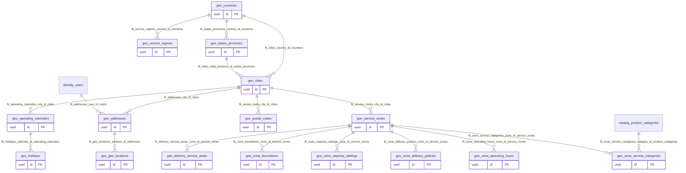

## identity

```mermaid
erDiagram
  identity_auth_rate_buckets { uuid id PK }
  identity_login_attempts { uuid id PK }
  identity_permissions { uuid id PK }
  identity_roles { uuid id PK }
  identity_users { uuid id PK }
  identity_customer_profiles { uuid id PK }
  identity_users ||--o{ identity_customer_profiles : "fk_customer_profiles_user_id_users"
  identity_external_identities { uuid id PK }
  identity_users ||--o{ identity_external_identities : "fk_external_identities_user_id_users"
  identity_organizations { uuid id PK }
  identity_users ||--o{ identity_organizations : "fk_organizations_owner_id_users"
  identity_role_permissions { uuid id PK }
  identity_permissions ||--o{ identity_role_permissions : "fk_role_permissions_permission_id_permissions"
  identity_roles ||--o{ identity_role_permissions : "fk_role_permissions_role_id_roles"
  identity_sessions { uuid id PK }
  identity_users ||--o{ identity_sessions : "fk_sessions_user_id_users"
  identity_user_credentials { uuid id PK }
  identity_users ||--o{ identity_user_credentials : "fk_user_credentials_user_id_users"
  identity_user_devices { uuid id PK }
  identity_users ||--o{ identity_user_devices : "fk_user_devices_user_id_users"
  identity_user_email_addresses { uuid id PK }
  identity_users ||--o{ identity_user_email_addresses : "fk_user_email_addresses_user_id_users"
  identity_user_phone_numbers { uuid id PK }
  identity_users ||--o{ identity_user_phone_numbers : "fk_user_phone_numbers_user_id_users"
  identity_user_profiles { uuid id PK }
  identity_users ||--o{ identity_user_profiles : "fk_user_profiles_user_id_users"
  identity_verification_challenges { uuid id PK }
  identity_users ||--o{ identity_verification_challenges : "fk_verification_challenges_user_id_users"
  identity_authentication_events { uuid id PK }
  identity_sessions ||--o{ identity_authentication_events : "fk_authentication_events_session_id_sessions"
  identity_users ||--o{ identity_authentication_events : "fk_authentication_events_user_id_users"
  identity_invitations { uuid id PK }
  identity_organizations ||--o{ identity_invitations : "fk_invitations_organization_id_organizations"
  identity_roles ||--o{ identity_invitations : "fk_invitations_role_id_roles"
  identity_organization_memberships { uuid id PK }
  identity_organizations ||--o{ identity_organization_memberships : "fk_organization_memberships_organization_id_organizations"
  identity_users ||--o{ identity_organization_memberships : "fk_organization_memberships_user_id_users"
  identity_organization_settings { uuid id PK }
  identity_organizations ||--o{ identity_organization_settings : "fk_organization_settings_organization_id_organizations"
  identity_refresh_tokens { uuid id PK }
  identity_sessions ||--o{ identity_refresh_tokens : "fk_refresh_tokens_session_id_sessions"
  identity_user_role_assignments { uuid id PK }
  merchant_merchant_branches ||--o{ identity_user_role_assignments : "fk_user_role_assignments_branch_id_merchant_branches"
  geo_cities ||--o{ identity_user_role_assignments : "fk_user_role_assignments_city_id_cities"
  identity_organizations ||--o{ identity_user_role_assignments : "fk_user_role_assignments_organization_id_organizations"
  identity_roles ||--o{ identity_user_role_assignments : "fk_user_role_assignments_role_id_roles"
  identity_users ||--o{ identity_user_role_assignments : "fk_user_role_assignments_user_id_users"
```

## integration

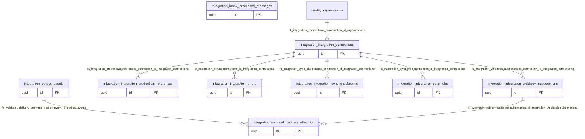

## intelligence

```mermaid
erDiagram
  intelligence_ai_feature_definitions { uuid id PK }
  intelligence_ai_feature_pipeline_runs { uuid id PK }
  intelligence_ai_model_registry { uuid id PK }
  intelligence_ai_feature_snapshots { uuid id PK }
  intelligence_ai_feature_definitions ||--o{ intelligence_ai_feature_snapshots : "fk_ai_feature_snapshots_feature_id_ai_feature_definitions"
  intelligence_ai_model_versions { uuid id PK }
  identity_users ||--o{ intelligence_ai_model_versions : "fk_ai_model_versions_approved_by_users"
  intelligence_ai_model_registry ||--o{ intelligence_ai_model_versions : "fk_ai_model_versions_model_id_ai_model_registry"
  intelligence_ai_training_jobs { uuid id PK }
  intelligence_ai_model_registry ||--o{ intelligence_ai_training_jobs : "fk_ai_training_jobs_model_id_ai_model_registry"
  intelligence_ai_agent_sessions { uuid id PK }
  identity_organizations ||--o{ intelligence_ai_agent_sessions : "fk_ai_agent_sessions_organization_id_organizations"
  identity_users ||--o{ intelligence_ai_agent_sessions : "fk_ai_agent_sessions_user_id_users"
  intelligence_ai_evaluation_runs { uuid id PK }
  intelligence_ai_model_versions ||--o{ intelligence_ai_evaluation_runs : "fk_ai_evaluation_runs_version_id_ai_model_versions"
  intelligence_ai_inference_runs { uuid id PK }
  identity_users ||--o{ intelligence_ai_inference_runs : "fk_ai_inference_runs_actor_id_users"
  identity_organizations ||--o{ intelligence_ai_inference_runs : "fk_ai_inference_runs_organization_id_organizations"
  intelligence_ai_model_versions ||--o{ intelligence_ai_inference_runs : "fk_ai_inference_runs_version_id_ai_model_versions"
  intelligence_ai_agent_tool_calls { uuid id PK }
  intelligence_ai_agent_sessions ||--o{ intelligence_ai_agent_tool_calls : "fk_ai_agent_tool_calls_session_id_ai_agent_sessions"
  intelligence_ai_feedback { uuid id PK }
  intelligence_ai_inference_runs ||--o{ intelligence_ai_feedback : "fk_ai_feedback_run_id_ai_inference_runs"
  identity_users ||--o{ intelligence_ai_feedback : "fk_ai_feedback_user_id_users"
  intelligence_ai_optimization_decisions { uuid id PK }
  geo_cities ||--o{ intelligence_ai_optimization_decisions : "fk_ai_optimization_decisions_city_id_cities"
  intelligence_ai_prediction_records { uuid id PK }
  intelligence_ai_inference_runs ||--o{ intelligence_ai_prediction_records : "fk_ai_prediction_records_run_id_ai_inference_runs"
  intelligence_ai_risk_signals { uuid id PK }
  intelligence_ai_inference_runs ||--o{ intelligence_ai_risk_signals : "fk_ai_risk_signals_run_id_ai_inference_runs"
  intelligence_ai_agent_action_approvals { uuid id PK }
  identity_users ||--o{ intelligence_ai_agent_action_approvals : "fk_ai_agent_action_approvals_approver_id_users"
  intelligence_ai_agent_tool_calls ||--o{ intelligence_ai_agent_action_approvals : "fk_ai_agent_action_approvals_tool_call_id_ai_agent_tool_calls"
  intelligence_ai_forecast_outputs { uuid id PK }
  geo_cities ||--o{ intelligence_ai_forecast_outputs : "fk_ai_forecast_outputs_city_id_cities"
  geo_service_zones ||--o{ intelligence_ai_forecast_outputs : "fk_ai_forecast_outputs_zone_id_service_zones"
```

## inventory

```mermaid
erDiagram
  inventory_inventory_locations { uuid id PK }
  merchant_merchant_branches ||--o{ inventory_inventory_locations : "fk_inventory_locations_branch_id_merchant_branches"
  inventory_inventory_policy_settings { uuid id PK }
  merchant_merchant_branches ||--o{ inventory_inventory_policy_settings : "fk_inventory_policy_settings_branch_id_merchant_branches"
  inventory_stock_balances { uuid id PK }
  merchant_merchant_branches ||--o{ inventory_stock_balances : "fk_stock_balances_branch_id_merchant_branches"
  catalog_product_variants ||--o{ inventory_stock_balances : "fk_stock_balances_variant_id_product_variants"
  inventory_inventory_alerts { uuid id PK }
  inventory_stock_balances ||--o{ inventory_inventory_alerts : "fk_inventory_alerts_stock_id_stock_balances"
  inventory_inventory_items { uuid id PK }
  inventory_inventory_locations ||--o{ inventory_inventory_items : "fk_inventory_items_location_id_inventory_locations"
  catalog_product_variants ||--o{ inventory_inventory_items : "fk_inventory_items_variant_id_product_variants"
  inventory_stock_batches { uuid id PK }
  inventory_stock_balances ||--o{ inventory_stock_batches : "fk_stock_batches_stock_id_stock_balances"
  inventory_stock_count_sessions { uuid id PK }
  inventory_inventory_locations ||--o{ inventory_stock_count_sessions : "fk_stock_count_sessions_location_id_inventory_locations"
  identity_users ||--o{ inventory_stock_count_sessions : "fk_stock_count_sessions_started_by_users"
  inventory_expiry_dates { uuid id PK }
  inventory_stock_batches ||--o{ inventory_expiry_dates : "fk_expiry_dates_batch_id_stock_batches"
  inventory_stock_count_lines { uuid id PK }
  inventory_stock_count_sessions ||--o{ inventory_stock_count_lines : "fk_stock_count_lines_session_id_stock_count_sessions"
  catalog_product_variants ||--o{ inventory_stock_count_lines : "fk_stock_count_lines_variant_id_product_variants"
  inventory_stock_reservations { uuid id PK }
  commerce_order_items ||--o{ inventory_stock_reservations : "fk_stock_reservations_order_item_id_order_items"
  inventory_stock_balances ||--o{ inventory_stock_reservations : "fk_stock_reservations_stock_id_stock_balances"
  inventory_batch_reservation_allocations { uuid id PK }
  inventory_stock_batches ||--o{ inventory_batch_reservation_allocations : "fk_batch_reservation_allocations_batch_id_stock_batches"
  inventory_stock_reservations ||--o{ inventory_batch_reservation_allocations : "fk_batch_reservation_allocations_reservation_id_stock_reservations"
  inventory_reservation_expirations { uuid id PK }
  inventory_stock_reservations ||--o{ inventory_reservation_expirations : "fk_reservation_expirations_reservation_id_stock_reservations"
  inventory_stock_movements { uuid id PK }
  identity_users ||--o{ inventory_stock_movements : "fk_stock_movements_actor_id_users"
  inventory_stock_batches ||--o{ inventory_stock_movements : "fk_stock_movements_batch_id_stock_batches"
  inventory_stock_reservations ||--o{ inventory_stock_movements : "fk_stock_movements_reservation_id_stock_reservations"
  inventory_stock_balances ||--o{ inventory_stock_movements : "fk_stock_movements_stock_id_stock_balances"
  inventory_stock_adjustments { uuid id PK }
  identity_users ||--o{ inventory_stock_adjustments : "fk_stock_adjustments_approved_by_users"
  inventory_stock_movements ||--o{ inventory_stock_adjustments : "fk_stock_adjustments_movement_id_stock_movements"
```

## merchant

```mermaid
erDiagram
  merchant_merchant_categories { uuid id PK }
  merchant_merchant_brands { uuid id PK }
  identity_organizations ||--o{ merchant_merchant_brands : "fk_merchant_brands_organization_id_organizations"
  merchant_merchant_documents { uuid id PK }
  identity_organizations ||--o{ merchant_merchant_documents : "fk_merchant_documents_organization_id_organizations"
  merchant_merchant_legal_entities { uuid id PK }
  geo_countries ||--o{ merchant_merchant_legal_entities : "fk_merchant_legal_entities_country_id_countries"
  identity_organizations ||--o{ merchant_merchant_legal_entities : "fk_merchant_legal_entities_organization_id_organizations"
  merchant_merchant_organizations { uuid id PK }
  identity_organizations ||--o{ merchant_merchant_organizations : "fk_merchant_organizations_organization_id_organizations"
  merchant_merchant_bank_accounts { uuid id PK }
  merchant_merchant_legal_entities ||--o{ merchant_merchant_bank_accounts : "fk_merchant_bank_accounts_legal_entity_id_merchant_legal_entities"
  merchant_merchant_branches { uuid id PK }
  merchant_merchant_brands ||--o{ merchant_merchant_branches : "fk_merchant_branches_brand_id_merchant_brands"
  geo_cities ||--o{ merchant_merchant_branches : "fk_merchant_branches_city_id_cities"
  identity_organizations ||--o{ merchant_merchant_branches : "fk_merchant_branches_organization_id_organizations"
  merchant_merchant_category_assignments { uuid id PK }
  merchant_merchant_brands ||--o{ merchant_merchant_category_assignments : "fk_merchant_category_assignments_brand_id_merchant_brands"
  merchant_merchant_categories ||--o{ merchant_merchant_category_assignments : "fk_merchant_category_assignments_category_id_merchant_categories"
  merchant_merchant_contracts { uuid id PK }
  merchant_merchant_legal_entities ||--o{ merchant_merchant_contracts : "fk_merchant_contracts_legal_entity_id_merchant_legal_entities"
  identity_organizations ||--o{ merchant_merchant_contracts : "fk_merchant_contracts_organization_id_organizations"
  merchant_merchant_tax_registrations { uuid id PK }
  geo_countries ||--o{ merchant_merchant_tax_registrations : "fk_merchant_tax_registrations_country_id_countries"
  merchant_merchant_legal_entities ||--o{ merchant_merchant_tax_registrations : "fk_merchant_tax_registrations_legal_entity_id_merchant_legal_entities"
  merchant_merchant_commission_agreements { uuid id PK }
  merchant_merchant_contracts ||--o{ merchant_merchant_commission_agreements : "fk_merchant_commission_agreements_contract_id_merchant_contracts"
  merchant_merchant_fulfillment_capabilities { uuid id PK }
  merchant_merchant_branches ||--o{ merchant_merchant_fulfillment_capabilities : "fk_merchant_fulfillment_capabilities_branch_id_merchant_branches"
  merchant_merchant_onboarding_reviews { uuid id PK }
  merchant_merchant_branches ||--o{ merchant_merchant_onboarding_reviews : "fk_merchant_onboarding_reviews_branch_id_merchant_branches"
  identity_users ||--o{ merchant_merchant_onboarding_reviews : "fk_merchant_onboarding_reviews_reviewer_id_users"
  merchant_merchant_operating_hours { uuid id PK }
  merchant_merchant_branches ||--o{ merchant_merchant_operating_hours : "fk_merchant_operating_hours_branch_id_merchant_branches"
  merchant_merchant_special_hours { uuid id PK }
  merchant_merchant_branches ||--o{ merchant_merchant_special_hours : "fk_merchant_special_hours_branch_id_merchant_branches"
  merchant_merchant_staff { uuid id PK }
  merchant_merchant_branches ||--o{ merchant_merchant_staff : "fk_merchant_staff_branch_id_merchant_branches"
  identity_organizations ||--o{ merchant_merchant_staff : "fk_merchant_staff_organization_id_organizations"
  identity_users ||--o{ merchant_merchant_staff : "fk_merchant_staff_user_id_users"
  merchant_merchant_status_history { uuid id PK }
  identity_users ||--o{ merchant_merchant_status_history : "fk_merchant_status_history_actor_id_users"
  merchant_merchant_branches ||--o{ merchant_merchant_status_history : "fk_merchant_status_history_branch_id_merchant_branches"
  merchant_merchant_temporary_closures { uuid id PK }
  merchant_merchant_branches ||--o{ merchant_merchant_temporary_closures : "fk_merchant_temporary_closures_branch_id_merchant_branches"
  merchant_merchant_service_areas { uuid id PK }
  geo_delivery_service_areas ||--o{ merchant_merchant_service_areas : "fk_merchant_service_areas_area_id_delivery_service_areas"
  merchant_merchant_branches ||--o{ merchant_merchant_service_areas : "fk_merchant_service_areas_branch_id_merchant_branches"
  catalog_product_categories ||--o{ merchant_merchant_service_areas : "fk_merchant_service_areas_category_id_product_categories"
  merchant_merchant_staff_roles { uuid id PK }
  identity_roles ||--o{ merchant_merchant_staff_roles : "fk_merchant_staff_roles_role_id_roles"
  merchant_merchant_staff ||--o{ merchant_merchant_staff_roles : "fk_merchant_staff_roles_staff_id_merchant_staff"
```

## operations

```mermaid
erDiagram
  operations_service_health_events { uuid id PK }
  operations_support_categories { uuid id PK }
  operations_notification_jobs { uuid id PK }
  integration_outbox_events ||--o{ operations_notification_jobs : "fk_notification_jobs_event_id_outbox_events"
  engagement_communication_templates ||--o{ operations_notification_jobs : "fk_notification_jobs_template_id_communication_templates"
  identity_users ||--o{ operations_notification_jobs : "fk_notification_jobs_user_id_users"
  operations_notification_attempts { uuid id PK }
  operations_notification_jobs ||--o{ operations_notification_attempts : "fk_notification_attempts_job_id_notification_jobs"
  operations_notification_deliveries { uuid id PK }
  operations_notification_jobs ||--o{ operations_notification_deliveries : "fk_notification_deliveries_job_id_notification_jobs"
  operations_operational_incidents { uuid id PK }
  geo_cities ||--o{ operations_operational_incidents : "fk_operational_incidents_city_id_cities"
  operations_refund_approval_requests { uuid id PK }
  commerce_orders ||--o{ operations_refund_approval_requests : "fk_refund_approval_requests_order_id_orders"
  identity_organizations ||--o{ operations_refund_approval_requests : "fk_refund_approval_requests_organization_id_organizations"
  identity_users ||--o{ operations_refund_approval_requests : "fk_refund_approval_requests_requested_by_users"
  operations_support_tickets { uuid id PK }
  commerce_orders ||--o{ operations_support_tickets : "fk_support_tickets_order_id_orders"
  identity_organizations ||--o{ operations_support_tickets : "fk_support_tickets_organization_id_organizations"
  identity_users ||--o{ operations_support_tickets : "fk_support_tickets_user_id_users"
  operations_refund_approval_decisions { uuid id PK }
  identity_users ||--o{ operations_refund_approval_decisions : "fk_refund_approval_decisions_decided_by_users"
  operations_refund_approval_requests ||--o{ operations_refund_approval_decisions : "fk_refund_approval_decisions_request_id_refund_approval_requests"
  operations_support_escalations { uuid id PK }
  identity_users ||--o{ operations_support_escalations : "fk_support_escalations_raised_by_users"
  operations_support_tickets ||--o{ operations_support_escalations : "fk_support_escalations_ticket_id_support_tickets"
  operations_support_ticket_messages { uuid id PK }
  identity_users ||--o{ operations_support_ticket_messages : "fk_support_ticket_messages_author_id_users"
  operations_support_tickets ||--o{ operations_support_ticket_messages : "fk_support_ticket_messages_ticket_id_support_tickets"
  operations_ticket_assignments { uuid id PK }
  identity_users ||--o{ operations_ticket_assignments : "fk_ticket_assignments_agent_id_users"
  operations_support_tickets ||--o{ operations_ticket_assignments : "fk_ticket_assignments_ticket_id_support_tickets"
```

Each diagram groups child tables by namespace; external parents retain their schema prefix.
Columns and nullability are fully specified in the dictionary and machine schema.
Actual applied-migration/catalog evidence is in ../operations/phase-2-database-evidence.json.
